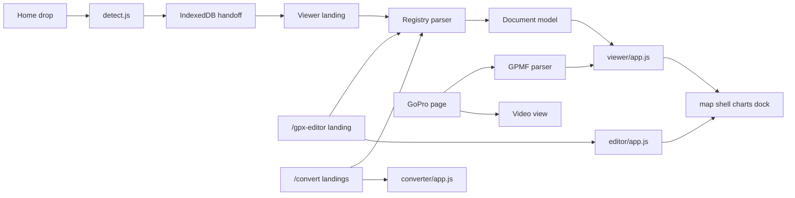

# P7 — three meta tools

Leave every change uncommitted. Keep the existing hard rules (no email or contact, no “Report a map issue”, no OSM credit in the footer, no FlySight, no heavy one-sided colour borders, tiles only through [config/tiles.php](config/tiles.php) and [public/assets/js/map/tiles.js](public/assets/js/map/tiles.js)).

**Writable formats:** GPX, KML, KMZ, and the existing CSV spreadsheet export. FIT stays read-only (no FIT encoder). The editor and converter offer every writable format; FIT is an input only.

Same split for all three tools. Each **app module** accepts only the shared document (`{ name, segments, waypoints }` from the parsers, then `buildTrack()`). It does not detect a format, read a `File`, or import a parser. The **SEO landing** for that URL owns the drop zone, runs the registry parser, and hands the document to the module.

Map, chart, and dock modules stay in `public/assets/js/map/` (`map-shell`, `track-layer`, `track-charts`, `graph-dock`, `panels`). The viewer and the editor both import those files. There is no second map or chart implementation. Measure distance, the coordinate converter, and the video mini-map keep importing the same files.

## 1. Format registry

Add [config/formats.php](config/formats.php), one row per format:

- `gpx`, `kml`, `kmz`, `fit`
- extensions, accept string, label
- magic hint: `xml-root` (`gpx` / `kml`), `zip` (KMZ), `ascii` at offset 8 (`.FIT`)
- parser module URL (KMZ reuses [public/assets/js/parsers/kml.js](public/assets/js/parsers/kml.js); all four already return `{ name, segments, waypoints }`)
- exporter id, `writable` (FIT false), landing path and slug
- landing title, description, schema name, FAQ

Emit `window.GPS_FORMATS` from a partial, same pattern as [includes/partials/tile-config.php](includes/partials/tile-config.php), on the home page, map pages, and the converter.

New [public/assets/js/core/detect.js](public/assets/js/core/detect.js): extension when it names a format; otherwise magic (and magic wins for `.xml`, `.zip`, or a missing extension). [public/assets/js/core/formats.js](public/assets/js/core/formats.js) loads a parser with `import(url)` and calls `parse(file)`. No tool module branches on format.

Add a stored-method ZIP writer next to the reader in [public/assets/js/parsers/zip.js](public/assets/js/parsers/zip.js), and `toKmzDocument` in [public/assets/js/core/exporters.js](public/assets/js/core/exporters.js) (one `doc.kml` entry). Export menu ids become `gpx`, `kml`, `kmz`, `csv`.

[config/tools.php](config/tools.php) registers viewer routes by looping the format rows (shared entry below) plus the editor, `/convert`, and the pair list. [includes/seo.php](includes/seo.php) already walks the registry, so the sitemap picks up every `inSitemap` route and drops the old converter URLs once they leave the registry.

## 2. Shared viewer

New [public/assets/js/viewer/app.js](public/assets/js/viewer/app.js): move the view path out of [public/assets/js/tools/gpx-viewer.js](public/assets/js/tools/gpx-viewer.js) (enter map, draw the active track, waypoints, stats, charts, export, progress, cancel). Strip GPX checks and every edit import. Public API: `mount()`, `open(doc, fileLabel)`, `clear()`. It only accepts the document the parsers already return, then `buildTrack()` from [public/assets/js/core/track.js](public/assets/js/core/track.js).

[public/assets/js/map/panels.js](public/assets/js/map/panels.js) builds export buttons from a list the viewer passes (registry writable formats + CSV), instead of hardcoded GPX/CSV/KML.

New [public/assets/js/viewer/landing.js](public/assets/js/viewer/landing.js): one boot for every format landing. Reads `data-format` on the page, drop or handoff file in, dynamic-imports that format’s parser, calls `viewer.open`. An Edit control stashes the original file via [public/assets/js/core/file-handoff.js](public/assets/js/core/file-handoff.js) and goes to `/gpx-editor`.

Shared PHP shell [includes/pages/format-viewer.php](includes/pages/format-viewer.php): that format’s `content.php`, then [includes/layout/map-app.php](includes/layout/map-app.php) with edit off and video off, accept and drop copy from the registry. Each landing is `tools/<slug>/content.php` plus a short `page.php` that sets the format id. Delete `public/assets/js/tools/gpx-viewer.js` after the move.

Rewrite [tools/gpx-viewer/content.php](tools/gpx-viewer/content.php) and [tools/gpx-viewer/meta.php](tools/gpx-viewer/meta.php) as view-only (title **Free Online GPX Viewer**). Add `tools/kml-viewer`, `tools/kmz-viewer`, `tools/fit-viewer` with their own H1, intro, how-to, and FAQ. Cross-links go to `/gpx-editor` and `/convert/<pair>`, not the old converter paths.

Home [public/assets/js/dropzone.js](public/assets/js/dropzone.js) drops the hardcoded route table. It uses `detect` + the registry landing path. `.mp4` / `.lrv` stay a GoPro handoff (not a format row).

## 3. GoPro on the same viewer

[public/assets/js/tools/gopro-gps-extract.js](public/assets/js/tools/gopro-gps-extract.js) keeps GPMF parse, progress, and [public/assets/js/video/overlay.js](public/assets/js/video/overlay.js). It deletes its copy of `enterTool`, track draw, charts, stats, and export, and calls `viewer.open` with one segment. Map|Video switch and video sync stay here. Export of the GoPro track uses the same viewer export list. The Edit handoff stashes a GPX built from the track, because the editor does not take video.

## 4. Editor at `/gpx-editor`

`/gpx-editor` is an SEO landing: `tools/gpx-editor/` (meta, content, page), map page, ads off. Content and drop zone sit above the map shell. [public/assets/js/editor/landing.js](public/assets/js/editor/landing.js) is the page boot. It accepts one or more files, detects and parses each through the registry, and calls the editor with the documents. Accept string comes from the registry.

[public/assets/js/editor/app.js](public/assets/js/editor/app.js) is the generic editor. It imports no parser. `open(doc)` / `add(doc)` take the shared document only. Drawing, stats, and charts go through the same `map/*` modules as the viewer (including `track-layer.showPreview` for a live edit). It does not embed or fork `viewer/app.js`.

- Move [public/assets/js/map/edit-tools.js](public/assets/js/map/edit-tools.js) to `public/assets/js/editor/edit-tools.js` and load it only from the editor. [includes/layout/map-app.php](includes/layout/map-app.php) still holds the edit markup, rendered only when `$mapShellEdit` is set.
- Ops already in [public/assets/js/core/edit.js](public/assets/js/core/edit.js): trim, simplify, reverse, elevation fix, undo.
- New ops in `edit.js`: **merge** (concatenate the listed segments into one) and **split** (cut the active segment at an index). Buttons in the edit panel.
- Export calls the registry exporter for every writable format, plus CSV. GPX/KML/KMZ keep every segment and the waypoints; CSV is the segment on screen (same rule as today’s GPX viewer). The exporter writes the document; the editor still does not parse.

`/gpx-viewer` no longer shows edit controls.

## 5. Converter at `/convert`

[public/assets/js/converter/app.js](public/assets/js/converter/app.js) is the generic converter. It imports no parser. `open(doc, toId)` takes the shared document and a target exporter id, builds the file, and offers download. “View on the map” stashes that output file and opens the target format’s landing.

[public/assets/js/converter/landing.js](public/assets/js/converter/landing.js) is the only page boot, used by `/convert` and every `/convert/<pair>` URL. The page is the SEO landing (unique intro and FAQ around the drop zone). The boot:

- Fills from / to from the registry (any format in, writable formats out, not the same id).
- Preselects from `data-from` / `data-to` on the page, then from `?from=&to=` (`/convert?from=kml&to=gpx`).
- On drop, detects and parses with the registry, then calls `converter.open(doc, toId)`.

Delete [public/assets/js/tools/convert-app.js](public/assets/js/tools/convert-app.js) after the move. That file parses inside the tool; parsing moves to the landing boot.

[config/convert.php](config/convert.php) lists the six pairs (`kml-to-gpx`, `gpx-to-kml`, `fit-to-gpx`, `kmz-to-gpx`, `gpx-to-kmz`, `kmz-to-kml`) with from, to, title, description, and FAQ. [tools/convert/page.php](tools/convert/page.php) is the only page. Hub copy in `tools/convert/content.php`. Each pair’s unique intro is `tools/convert/pairs/<slug>.php`, included above the shared card from [includes/partials/converter-card.php](includes/partials/converter-card.php). Canonical stays the request path ([includes/seo.php](includes/seo.php) already ignores the query string), so each pair is self-canonical and `/convert?from=&to=` canonicalizes to `/convert`.

301s in [public/.htaccess](public/.htaccess), before the front controller:

- `/kml-to-gpx` → `/convert/kml-to-gpx`
- `/gpx-to-kml` → `/convert/gpx-to-kml`
- `/fit-to-gpx` → `/convert/fit-to-gpx`

Remove those three entries from [config/tools.php](config/tools.php) and delete `tools/kml-to-gpx`, `tools/gpx-to-kml`, `tools/fit-to-gpx`, and `public/assets/js/tools/{kml-to-gpx,gpx-to-kml,fit-to-gpx}.js`. Reuse their intro and FAQ in the matching pair files, with links updated to `/convert/...`, `/gpx-viewer`, and `/gpx-editor`. Write new copy for the three KMZ pairs.

Adding a later pair is a row in `config/convert.php` plus a pair content file. Adding a later format is a row in `config/formats.php` plus `tools/<slug>/content.php`. No new tool JS.

## 6. Menu and docs

[includes/layout/topbar.php](includes/layout/topbar.php):

- **Viewers:** GPX, KML, KMZ, FIT
- **More:** GoPro (`/gopro-gps-extract`)
- **Tools:** Coordinate converter, Measure distance, Converter (`/convert`)

Highlight Tools for `/convert` and any `/convert/...` path (`nav_active` is exact-match today).

Update [docs/architecture.md](docs/architecture.md) (P7 landed; modules at `public/assets/js/viewer/`, `editor/`, and `converter/`; landings parse, modules take the document only) and the structure lines in [.cursor/rules/gps-toolset.mdc](.cursor/rules/gps-toolset.mdc). Point the old converter rows in [docs/seo-keywords.md](docs/seo-keywords.md) and [docs/design-direction.md](docs/design-direction.md) at `/convert/...`. Mark P7 done in [docs/cursor-prompts.md](docs/cursor-prompts.md).

## 7. Check on http://gpstoolset.lan/

- Curl: new URLs **200** (`/`, `/gpx-viewer`, `/kml-viewer`, `/kmz-viewer`, `/fit-viewer`, `/gpx-editor`, `/convert`, six `/convert/...` pairs, `/gopro-gps-extract`, `/sitemap.xml`). Old `/kml-to-gpx`, `/gpx-to-kml`, `/fit-to-gpx` **301** to the pair URLs. Sitemap lists the new URLs and not the old ones.
- Browser: home drop of a small GPX, KML, KMZ, and FIT (in-page `File`, not a sample button) lands on the matching viewer and opens the same map shell. Editor landing parses a file and hands the document to `editor/app.js`, which runs merge, split, trim, simplify, reverse, and elevation fix on that model and downloads GPX, KML, KMZ, and CSV, using the same map and chart modules as the viewer. `/convert?from=kml&to=gpx` and `/convert/fit-to-gpx` preselect; the pair page parses and hands the document to `converter/app.js`. GoPro still boots Map and Video and calls the shared viewer rather than its own map glue.
